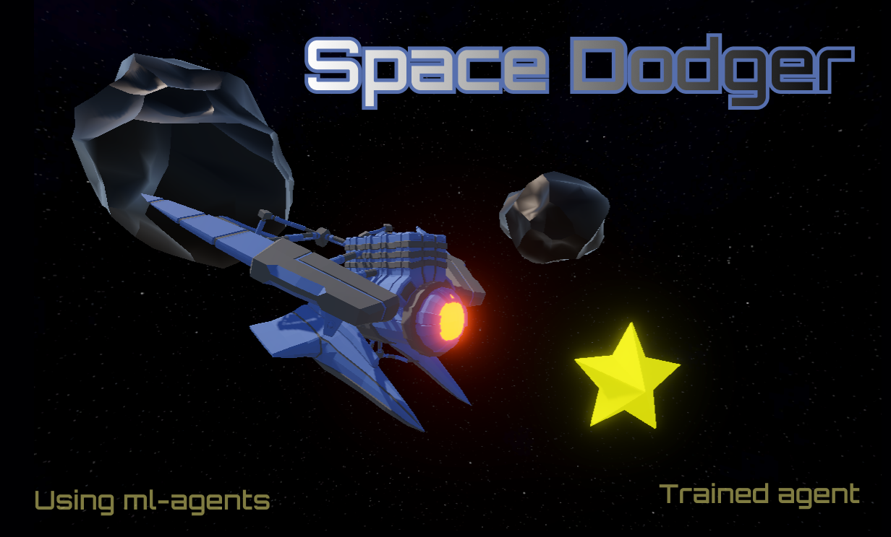

# Space Dodger



A 3D space survival game where a spaceship dodges asteroids, collects stars and shoots obstacles. The ship can be flown by you **or by an AI agent trained with Reinforcement Learning** using the [Unity ML-Agents Toolkit](https://github.com/Unity-Technologies/ml-agents).

## Features

- **Trained RL agent**: a PPO policy that learned to dodge obstacles on its own.
- **AI mode toggle**: a UI button switches the ship between AI control (`AI Mode ON`) and manual control (`AI Mode OFF`) at runtime.
- **Scoreboard**, spawning obstacles and stars, and a ship weapon.

## Controls (manual mode)

| Action | Keys |
| ------ | ---- |
| Move   | `W` `A` `S` `D` or arrow keys |
| Shoot  | Left mouse button |

Click the **AI Mode** button to hand control to the trained agent.

## Requirements

- Unity **6000.0.58f2** (Unity 6)
- ML-Agents Unity package `com.unity.ml-agents` **4.0.2** (installed via the Package Manager)
- Only for training: Python with the `mlagents` trainer package ([installation guide](https://github.com/Unity-Technologies/ml-agents/blob/develop/docs/Installation.md))

## Getting started

1. Clone the repository and open it with Unity Hub.
2. Open the scene `Assets/Scenes/MainLvl.unity`.
3. Press **Play**.

The trained models are in `Assets/AI Models/` (`.onnx`). The agent's *Behavior Parameters* component uses one of them for inference.

## How the agent works

Script: [`Assets/Scripts/SpaceshipAgent.cs`](Assets/Scripts/SpaceshipAgent.cs)

**Actions** (2 discrete branches)
- Horizontal: idle / left / right
- Vertical: idle / up / down

**Observations** (22 vector values + optional ray perception sensor)
- Ship position (x, y), normalized
- Last action taken (x, y)
- 3×3 "far" danger grid (obstacles up to 50 units ahead, for planning)
- 3×3 "close" danger grid (obstacles up to 15 units ahead, for immediate reaction)

**Rewards**

| Signal | Value |
| ------ | ----- |
| Survival, per step | `+0.005` |
| Moving while an obstacle is close | `+0.003 × danger` |
| Surviving the full episode (3000 steps) | `+2.0` |
| Crash | `-1.0` and episode ends |

## Training

Hyperparameters live in [`config/spaceship_config.yaml`](config/spaceship_config.yaml) (PPO, 3 layers × 256 units, `gamma` 0.995).

1. In the scene, set the ship's *Behavior Parameters* → *Behavior Type* to **Default** and *Behavior Name* to `Spaceship`.
2. Start the trainer:

   ```bash
   mlagents-learn config/spaceship_config.yaml --run-id=myRun
   ```

3. Press **Play** in the Unity Editor when the trainer asks for it.
4. Monitor progress with TensorBoard:

   ```bash
   tensorboard --logdir results
   ```

5. Copy `results/myRun/Spaceship.onnx` into `Assets/AI Models/` and assign it to the agent's *Model* field.

## Project structure

```
Assets/
  AI Models/   trained ONNX policies
  Scenes/      MainLvl.unity
  Scripts/
    SpaceshipAgent.cs       ML-Agents agent (observations, actions, rewards)
    AIToggleButton.cs       AI / manual mode switch
    ScoreBoard.cs
    Obstacles/              spawner, mover, collisions
    Player/                 movement, weapon, collisions
config/        ML-Agents training configuration
results/       training runs and checkpoints
```

## License

[MIT](LICENSE) © 2026 Dmytro Chekhovskyi
